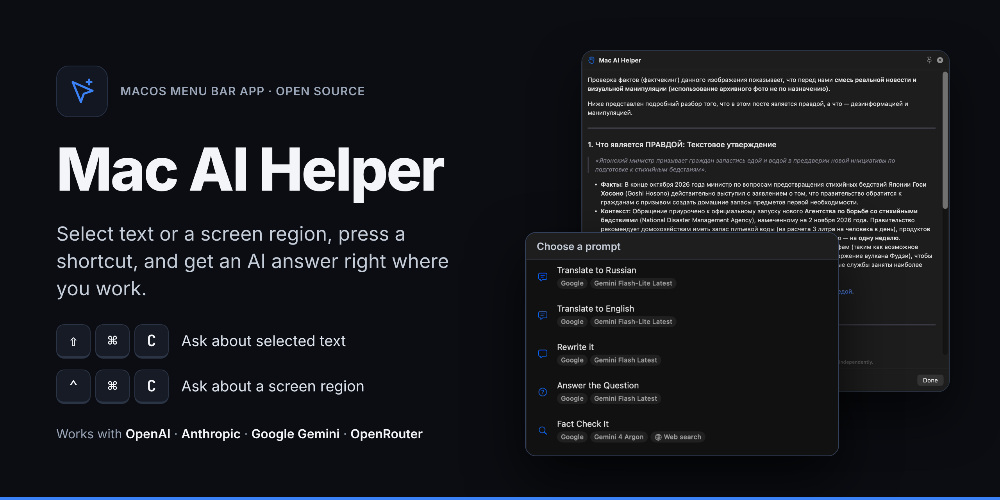
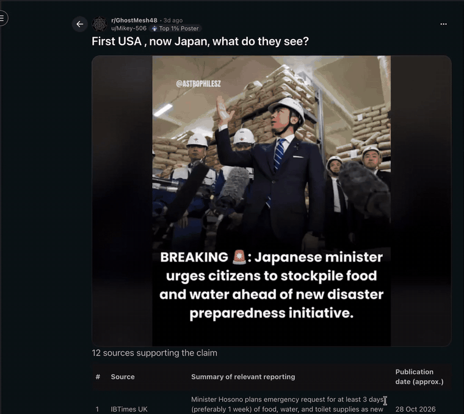
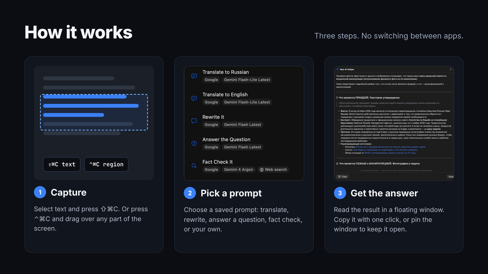
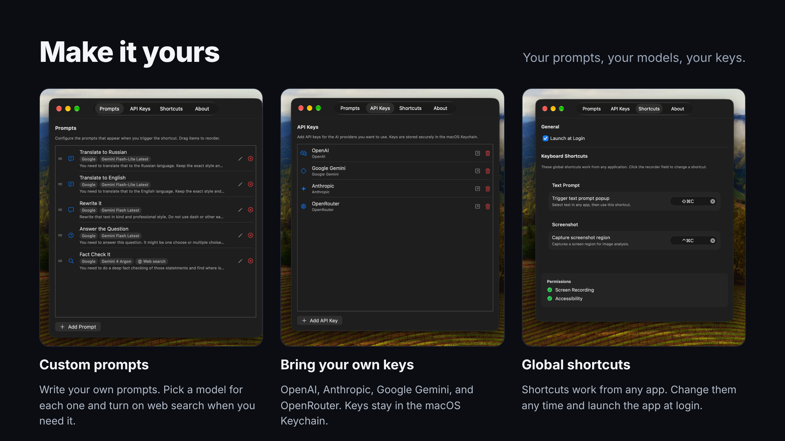

# Mac AI Helper

<p align="center">
  
</p>

A native macOS menu bar utility that captures selected text or screenshots via global keyboard shortcuts, presents a popup with predefined AI prompts, sends the content to a configured AI provider, and displays the response with copy functionality.

Free and open source under [GPL-3.0](LICENSE).

## How it works

<p align="center">
  
</p>

1. **Capture** — select text and press `⇧⌘C`, or press `⌃⌘C` and drag over any part of the screen.
2. **Pick a prompt** — translate, rewrite, answer a question, fact check, or your own prompt.
3. **Get the answer** — read the result in a floating window, copy it with one click, or pin the window.



## Features

- **Menu Bar Only** — Lives exclusively in the macOS menu bar (no Dock icon)
- **Global Shortcuts** — Trigger from any application (Carbon hotkeys, no permission needed)
  - `⇧⌘C` (`Cmd+Shift+C`) — Capture selected text and show prompt popup
  - `⌃⌘C` (`Ctrl+Cmd+C`) — Capture a screenshot region and show prompt popup
- **Multiple AI Providers** — Supports OpenAI, Anthropic (Claude), Google Gemini, and OpenRouter
- **Google Translate** — Near-instant translation; pick a target language as the prompt's model. Works without a key (free endpoint) or with your own Google Cloud Translation API key
- **Screenshot Translation** — A Google Translate prompt on a screenshot returns the image with its text translated in place; copy it or save it as a PNG
- **Dynamic Model Listing** — Fetches available models from each provider's API
- **Per-Prompt Models** — Each prompt uses its own model, picked in the prompt editor; outdated or unreachable models are flagged with badges
- **Custom Prompts** — Configure unlimited AI prompt templates
- **Local Key Storage** — API keys stay on your Mac, in a file only your user account can read
- **In-App Updates** — Checks GitHub Releases daily and installs a new version in one click
- **Native UI** — Built with SwiftUI, uses floating panels for the popup



## Installation

1. Download the latest `.dmg`, `.pkg` or `.zip` from [Releases](https://github.com/akazakou/mac-ai-helper/releases) (Universal — Apple Silicon and Intel, macOS 14+)
2. Install into `/Applications`
3. First launch: the app is not notarized by Apple, so macOS blocks it once per downloaded version. Open **System Settings → Privacy & Security** and click **Open Anyway**, or run:

   ```bash
   xattr -dr com.apple.quarantine /Applications/MacAIHelper.app
   ```

### Updates

The app checks GitHub Releases at launch and once a day. When a newer version exists, the menu bar
menu shows **Update to X.Y.Z and Relaunch** (also **Settings → About → Check for Updates**).
An update installed this way needs no **Open Anyway** step and keeps your permissions.
It works when the app was installed by drag and drop; a copy installed by the `.pkg` belongs to
`root`, so update it by downloading the new package.

## Setup

1. **Launch the app** — It will appear as an icon in the menu bar
2. **Add API keys** — Open Settings (click menu bar icon → Settings) → API Keys tab → Add keys for your preferred providers
3. **Configure prompts** — Settings → Prompts tab to add, edit, or reorder prompts
4. **Start using** — Select text in any app, press `⇧⌘C`, pick a prompt, and get AI responses!

### Google Translate (optional)

Google Translate answers much faster than an AI model. There are two ways to use it:

**Free, no key** — Settings → Prompts → Add Prompt → pick `[Google Translate Free] <language>` as the model.
This uses the keyless endpoint of the Google Translate web client. It is undocumented, so Google may
rate-limit or change it at any time.

**Official API, your own key** — stable and documented:

1. In [Google Cloud Console](https://console.cloud.google.com/apis/library/translate.googleapis.com), enable **Cloud Translation API** on a project with billing (the first 500,000 characters per month are free)
2. Create an API key under [Credentials](https://console.cloud.google.com/apis/credentials) and restrict it to Cloud Translation API
3. Settings → API Keys → Add API Key → provider **Google Translate**
4. Settings → Prompts → Add Prompt → pick `[Google Translate] <language>` as the model

The selected text is translated as is (no template), and the source language is detected automatically.

**Screenshots** — press `⌃⌘C`, select a region and pick a Google Translate prompt. The text is recognized on your Mac
(Apple Vision), only the recognized text is sent to Google, and the translation is drawn over the original text.
Use **Save Image…** to store the result as a PNG, or **Copy** to put it on the clipboard.
Google offers no API for its own image translation, so the result is simpler than on translate.google.com:
text is covered with a flat background color, which shows on photos and gradients.
The very first screenshot translation on a Mac can take up to half a minute while macOS prepares its text recognition models.
A Gemini (AI Studio) key works only if Cloud Translation API is enabled for that key's project.

## Requirements (development)

- macOS 14+ (Sonoma)
- Xcode 16+ / Swift 6.0+
- [XcodeGen](https://github.com/yonaskolb/XcodeGen) — generates `.xcodeproj` from `project.yml` (`brew install xcodegen`)

No Apple Developer Program membership is required.

## Development

```bash
swift build                 # compile
swift test                  # run unit tests
xcodegen generate && open MacAIHelper.xcodeproj   # run/debug from Xcode (Debug is "Sign to Run Locally")
```

The `.xcodeproj` is generated from `project.yml` and is not committed to git.

## Building & Releasing (GitHub Actions)

All release builds, signing and packaging run in [`.github/workflows/release.yml`](.github/workflows/release.yml) on the maintainer's self-hosted Apple Silicon runner.
Each run produces a Universal (arm64 + x86_64) app packaged as **DMG**, **PKG** and **ZIP**, plus `SHA256SUMS.txt`.

| Trigger | Result |
| --- | --- |
| Push tag `vX.Y.Z` | GitHub Release `vX.Y.Z` with all packages |
| Push tag `vX.Y.Z-beta.1` (any `-suffix`) | Same, marked as pre-release |
| **Actions → Build & Release → Run workflow** (any branch) | Test build; download the `.dmg`, `.pkg` and `.zip` (one artifact each) from the run's **Artifacts** |

```bash
git tag v1.2.0
git push origin v1.2.0
```

Version mapping: `CFBundleShortVersionString` comes from the tag without the `-suffix` (branch builds use the value in `SupportFiles/Info.plist`); `CFBundleVersion` is the workflow run number.

### Signing certificate

Releases are signed with a persistent **self-signed** code-signing certificate stored in GitHub Secrets.
macOS ties Accessibility / Screen Recording grants to the signing certificate,
so a stable certificate keeps users' permissions across updates. The in-app updater also installs
only a release signed with the same certificate as the running app. It does not replace Apple notarization:
Gatekeeper still asks users to confirm each version downloaded in a browser once.

One-time setup:

```bash
scripts/create-signing-cert.sh            # writes ~/.mac-ai-helper-signing/
base64 -i ~/.mac-ai-helper-signing/signing-cert.p12 | gh secret set MACOS_SIGNING_CERT_P12_BASE64
gh secret set MACOS_SIGNING_CERT_PASSWORD < ~/.mac-ai-helper-signing/signing-cert-password.txt
```

| Secret | Content |
| --- | --- |
| `MACOS_SIGNING_CERT_P12_BASE64` | Base64-encoded `.p12` (certificate + private key) |
| `MACOS_SIGNING_CERT_PASSWORD` | `.p12` password |

- Back up `~/.mac-ai-helper-signing/` in a password manager. Anyone holding the `.p12` can sign apps that inherit users' permission grants.
- Replacing the certificate resets every user's permissions once and stops in-app updates for installed copies (they must be updated by hand once).
- Without the secrets (e.g. in forks) the workflow falls back to ad-hoc signing and prints a warning; permissions then reset on every update and in-app updates are refused.

### Self-hosted runner

GitHub-hosted macOS runners are often capacity-constrained, so the workflow targets a self-hosted
runner with labels `self-hosted, macOS, ARM64, mac-ai-helper-release`. It runs as a LaunchAgent in
the maintainer's login session (signing needs the user keychain) and starts automatically at login.
With FileVault enabled, that is right after the first unlock following a boot.

Install / register (Apple Silicon, latest release from [actions/runner](https://github.com/actions/runner/releases)):

```bash
mkdir -p ~/actions-runner && cd ~/actions-runner
curl -fsSL -o runner.tar.gz https://github.com/actions/runner/releases/download/v<VERSION>/actions-runner-osx-arm64-<VERSION>.tar.gz
tar xzf runner.tar.gz && rm runner.tar.gz
./config.sh --unattended --url https://github.com/akazakou/mac-ai-helper \
  --token "$(gh api -X POST repos/akazakou/mac-ai-helper/actions/runners/registration-token --jq .token)" \
  --name "$(hostname -s)" --labels mac-ai-helper-release --work _work --replace
./svc.sh install && ./svc.sh start
```

Status / logs: `./svc.sh status`, `~/Library/Logs/actions.runner.akazakou-mac-ai-helper.*/`.

Remove:

```bash
cd ~/actions-runner && ./svc.sh uninstall
./config.sh remove --token "$(gh api -X POST repos/akazakou/mac-ai-helper/actions/runners/remove-token --jq .token)"
```

The same runner builds the code for CodeQL code scanning ([`.github/workflows/codeql.yml`](.github/workflows/codeql.yml)).

Security: jobs run with the runner user's privileges. The release workflow only starts on tag pushes and
manual runs by collaborators, code scanning also on pushes to `master` and weekly, and fork PRs from all outside contributors need approval — never add
`pull_request` triggers that target this runner.


## Architecture

```
project.yml                 # XcodeGen project spec (generates .xcodeproj)
Package.swift               # SPM package manifest (dependency declarations)
.github/workflows/          # Build, sign, package and release pipeline
scripts/                    # Icon generation, signing certificate creation
SupportFiles/               # Info.plist, icons, installer (.pkg) resources
Sources/MacAIHelper/
├── App/                    # App entry point (@main)
Sources/MacAIHelperLib/
├── App/                    # AppDelegate, FloatingPanelController, AppState
├── Models/                 # Data models (AIProvider, Prompt, AppSettings, etc.)
├── Services/               # Business logic (AI APIs, API key store, Updates, Hotkeys, etc.)
├── ViewModels/             # Observable state management
└── Views/                  # SwiftUI views (Settings, Popup, Result)
```

### Key Components

- **HotkeyService** — Global shortcuts via KeyboardShortcuts (Carbon RegisterEventHotKey)
- **AIServiceRouter** — Routes requests to OpenAI, Anthropic, Gemini, OpenRouter, or Google Translate (official API or free endpoint)
- **APIKeyStore** — API key storage in an owner-only JSON file in Application Support
- **UpdateService** — In-app updates from GitHub Releases with code signature verification
- **SettingsService** — JSON-based settings persistence in Application Support
- **FloatingPanelController** — NSPanel-based floating popup window
- **ScreenCaptureService** — Interactive screen region capture via ScreenCaptureKit

### Data Persistence

- **Settings** (`settings.json`) — Stored in `~/Library/Application Support/MacAIHelper/`.
- **API Keys** (`api-keys.json`) — Stored in the same folder, readable by your user account only. Not in the Keychain: macOS ties Keychain access to the exact binary of a self-signed app and asked for the login password after every update. Keys saved by versions up to 1.1.0 are moved out of the Keychain on first launch.
- **Keyboard Shortcuts & panel size** — Stored in the app's UserDefaults.

## Permissions

The app requires two macOS permissions:

- **Accessibility** — To simulate `⌘C` and copy the selected text (text prompt shortcut)
- **Screen Recording** — For capturing screenshot regions (screenshot shortcut)

Global keyboard shortcuts themselves use Carbon APIs and need no permission.

macOS binds privacy permissions to the app's **code signature**. If permissions show as
granted but don't work (e.g. they were granted to a differently signed build), reset and grant again:

```bash
tccutil reset Accessibility com.castloud.MacAIHelper
tccutil reset ScreenCapture com.castloud.MacAIHelper
```

Screen Recording usually requires relaunching the app after it is granted.

## Privacy

See [PRIVACY.md](PRIVACY.md).

- No data collected or transmitted to Castloud servers
- API keys stored locally in a file only your user account can read
- Content sent directly to user-configured AI providers
- No analytics or tracking

## Support

If the app is useful to you, consider [sponsoring development](https://github.com/sponsors/akazakou) ❤️

## License

[GNU General Public License v3.0](LICENSE). © 2026 Castloud.
